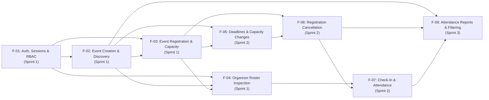

# Feature Inventory

**Course:** CPE 334 — Introduction to Software Engineering in the Age of AI Agents (Semester 1/2026)  
**Project Theme:** Theme 3 — Event Registration and Attendance System (University Skill-Building Context)  
**Team Name:** TH-011_SoftCookie  
**Document Version:** 1.1 (Engineering Baseline — Aligned with CPE 334 SDD/TDD Conventions)  
**Last Updated:** 2026-11-11  

---

## 1. Overview

This document inventories all baseline features (`F-01` through `F-08`) that collectively satisfy 100% of the Functional Requirements (`FR-01`–`FR-12`), Business Rules (`BR-01`–`BR-10`), and Non-Functional Requirements (`NFR-01`–`NFR-05`) defined in [`docs/srs.md`](./srs.md).

---

## 2. Feature Catalog

| Feature ID | Feature Name | Short Description | Related Requirements | Dependencies | Planned Sprint |
| :--- | :--- | :--- | :--- | :--- | :---: |
| **F-01** | Authentication, Session Lifecycle & Role-Based Access Control | Provides email/password login against `bcrypt`-hashed seeded accounts (`active` status), PostgreSQL-backed `HttpOnly` cookie sessions (`event_sys_session`), current-user identity endpoint (`GET /api/auth/me`), logout session revocation (`POST /api/auth/logout`), health & readiness probes (`GET /api/health`, `GET /api/ready`), and backend role/ownership authorization guards. | `FR-01`, `BR-04`, `BR-05`, `NFR-01`, `NFR-02`, `NFR-04`, `NFR-05` | None (Foundation) | **Sprint 1** |
| **F-02** | Event Creation, Publication & Discovery | Allows an authenticated `ORGANIZER` to create and publish university skill-building events with backend-generated `eventCode` (`EVT-YYYY-NNNN`), validated positive `capacity`, `skillCategory`, `skillHours`, schedule, and `registrationDeadline`. Allows authenticated users (`PARTICIPANT`, `ORGANIZER`) to browse published events and inspect event details with authoritative remaining seat counts. | `FR-02`, `FR-03`, `BR-01`, `BR-04`, `NFR-02`, `NFR-03`, `NFR-04`, `NFR-05` | `F-01` | **Sprint 1** |
| **F-03** | Event Registration & Capacity Enforcement | Allows an authenticated `PARTICIPANT` to register for a published event with available seats, generating an official `registrationNumber` (`REG-YYYY-NNNN`). Enforces positive remaining capacity (`BR-02`) and one active registration per participant per event (`BR-03`) inside a row-locked PostgreSQL transaction (`SELECT ... FOR UPDATE`) to prevent race conditions on the last seat. Allows participants to view `My Registrations` and owned registration details while blocking cross-participant access. | `FR-04`, `FR-05`, `BR-01`, `BR-02`, `BR-03`, `BR-04`, `BR-05`, `NFR-02`, `NFR-03`, `NFR-04`, `NFR-05` | `F-01`, `F-02` | **Sprint 1** |
| **F-04** | Organizer Event Registrations Inspection | Allows an authenticated `ORGANIZER` to inspect the participant registration roster for events they personally created (`event.organizerId === currentUser.id`). Enforces strict backend role and ownership boundaries so participants and non-owning organizers are rejected with `403 Forbidden`. | `FR-06`, `BR-04`, `BR-05`, `NFR-02`, `NFR-05` | `F-01`, `F-02`, `F-03` | **Sprint 1** |
| **F-05** | Registration Deadlines & Event Capacity Management | Allows an owning `ORGANIZER` to update an event's `capacity` and `registrationDeadline` (`PATCH /api/events/:id`), enforcing $\text{newCapacity} \ge \text{activeRegistrationsCount}$, $\text{newCapacity} \ge 1$, and $\text{registrationDeadline} \le \text{startAt}$. Enforces automatic backend rejection (`409 Conflict: DEADLINE_PASSED`) for registrations submitted after `registrationDeadline`. | `FR-07`, `FR-08`, `BR-01`, `BR-04`, `BR-05`, `BR-06`, `BR-07`, `NFR-02`, `NFR-03` | `F-02`, `F-03` | **Sprint 2** |
| **F-06** | Participant Registration Cancellation & Re-Registration | Allows an owning `PARTICIPANT` to cancel their active (`REGISTERED`) registration prior to `registrationDeadline` (`POST /api/registrations/:id/cancel`), transitioning status to `CANCELLED` and immediately restoring 1 available seat. Permits a participant with a `CANCELLED` registration to re-register if before the deadline and capacity is available. | `FR-09`, `BR-04`, `BR-05`, `BR-06`, `BR-08`, `NFR-02`, `NFR-03` | `F-03`, `F-05` | **Sprint 2** |
| **F-07** | Participant Check-In & Attendance Recording | Allows an owning `ORGANIZER` to check in participants who hold an active `REGISTERED` registration for their event (`POST /api/events/:id/registrations/:regId/check-in`), transitioning status to `ATTENDED` with a `checkedInAt` timestamp. Rejects invalid state transitions (checking in `CANCELLED` or already `ATTENDED` records, or cancelling an `ATTENDED` record). | `FR-10`, `BR-04`, `BR-05`, `BR-09`, `NFR-02`, `NFR-03` | `F-04`, `F-06` | **Sprint 2** |
| **F-08** | Attendance Reporting, Event Summaries & Filtering | Provides owning `ORGANIZER` users with an attendance summary dashboard per event (`capacity`, `registeredCount`, `cancelledCount`, `attendedCount`, `attendanceRatePercent`, `totalSkillHoursDelivered`) calculated on the server. Provides keyword search, skill-category filtering, availability filtering, and sorting on the event discovery catalog. | `FR-11`, `FR-12`, `BR-04`, `BR-05`, `BR-10`, `NFR-02`, `NFR-04`, `NFR-05` | `F-02`, `F-06`, `F-07` | **Sprint 3** |

---

## 3. Feature Dependency Graph

---

## 4. Baseline Coverage and Scope Change Log

* **Uncovered Requirements:** None (`0` uncovered requirements; 100% of `FR-01`–`FR-12`, `BR-01`–`BR-10`, and `NFR-01`–`NFR-05` are allocated to `F-01`–`F-08`).
* **Approved Scope Changes:**

| Change ID | Date | Affected IDs | Description & Rationale | Status |
| :--- | :--- | :--- | :--- | :--- |
| *None* | 2026-11-11 | Baseline v1.1 | Initial product baseline established prior to Sprint 1 implementation. | Baseline Frozen |
