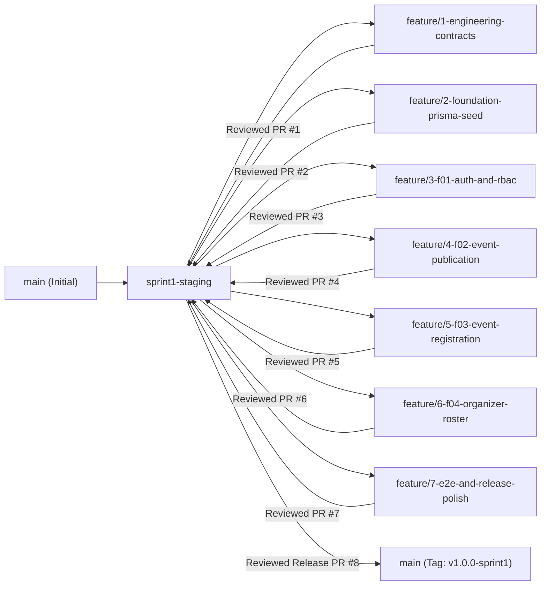

# Three-Sprint Development Plan & Git Workflow Decomposition

**Course:** CPE 334 — Introduction to Software Engineering in the Age of AI Agents (Semester 1/2026)  
**Project Theme:** Theme 3 — Event Registration and Attendance System (University Skill-Building Context)  
**Team Name:** TH-011_SoftCookie  
**Document Version:** 1.1 (Engineering Baseline — Aligned with CPE 334 SDD/TDD Conventions)  
**Last Updated:** 2026-11-11  

---

## 1. Three-Sprint Allocation Overview

The complete product baseline (`FR-01`–`FR-12`, `BR-01`–`BR-10`, `NFR-01`–`NFR-05`, and Features `F-01`–`F-08`) is allocated across three incremental sprints:

| Sprint | Checkpoint & Due Date | Sprint Goal | Included Features | Dependencies | Required Completion Outcome |
| :---: | :--- | :--- | :--- | :--- | :--- |
| **Sprint 1** | **Project Deliverable 1** Due: 8 Nov 2026 | Establish the authentication/authorization foundation and deliver a complete, persistent end-to-end vertical slice of event publication, participant registration with atomic capacity enforcement, and organizer roster inspection. | **F-01:** Auth, Session Lifecycle & RBAC **F-02:** Event Creation, Publication & Discovery **F-03:** Event Registration & Capacity Enforcement **F-04:** Organizer Event Registrations Inspection | None (Foundational baseline) | Working local release on `main` with PostgreSQL persistence, idempotent seeded data, automated Unit, API/Integration, UI Component, and E2E tests (`TEST-01`–`TEST-38`), and reviewed PR history. |
| **Sprint 2** | **Project Deliverable 2** Due: 29 Nov 2026 *(plus Labs 5–7 integration)* | Implement the core domain lifecycle expansions: registration deadline enforcement, organizer capacity/deadline updates, participant self-cancellation with seat release & re-registration, and organizer attendance check-in. | **F-05:** Registration Deadlines & Event Capacity Management **F-06:** Participant Registration Cancellation & Re-Registration **F-07:** Participant Check-In & Attendance Recording | `F-01`, `F-02`, `F-03`, `F-04` (Sprint 1 foundation + Lab 5 CI/CD & GCP pipeline) | All Sprint 2 features (`F-05`–`F-07`) 100% implemented, tested, reviewed, and integrated with Sprint 1; deployed on GCP via repeatable CI/CD pipeline; Sprint 3 contracts prepared and initial Sprint 3 progress demonstrated. |
| **Sprint 3** | **Progress at Deliverable 2** (29 Nov 2026) **Final Delivery** Due: 13 Dec 2026 | Complete remaining reporting and discovery workflows, harden failure/error handling, resolve UAT and maintenance findings, and verify the complete integrated product. | **F-08:** Attendance Reporting, Event Summaries & Event Filtering/Search *(plus cross-sprint hardening, UAT defect resolution & regression verification)* | `F-02`, `F-06`, `F-07` | Complete verified product (`F-01`–`F-08`) deployed on GCP with durable data, 100% baseline traceability, passing regression suite, UAT re-test verification, final PDF report, and demo video. |

---

## 2. GitHub Project Kanban and Branch Flow (CPE 334 Course Workflow)

Following the engineering discipline from Labs 1–4 and Section 8.3 of [`group_work_specs_v1.pdf`](../../group_work_specs_v1.pdf):

### 2.1 GitHub Project Kanban Board Columns
Every GitHub Issue moves strictly through the following six Kanban statuses in order:
1. **`Backlog`**: Issue is created and linked to its feature/requirement, but specification review has not yet started.
2. **`Specified`**: Feature engineering contract (`AC-xx`, `STS / TEST-xx`, API/UI/DB specs) is reviewed, approved, and ready to implement.
3. **`Started`**: Feature branch is created from the current sprint staging branch and TDD/implementation is actively underway.
4. **`PR Review`**: Pull Request into `sprint1-staging` (or `sprint2-staging` / `sprint3-staging`) is open and the partner is reviewing behavior, tests, and diffs.
5. **`Fixing`**: Teammate review requested changes or automated tests failed; fixes are being made on the same feature branch before returning to `PR Review`.
6. **`Done`**: Partner approved the PR (authors never approve their own PRs), automated tests pass, and the PR is merged into the staging branch.

### 2.2 Required Branching Topology

---

## 3. Sprint 1 GitHub Issues Decomposition

Before writing application code, Sprint 1 is decomposed into seven bounded GitHub Issues so both students participate across specifications, database, backend APIs, SoftCookie UI, automated tests, and peer reviews:

| Issue # | Issue Title & Type | Feature / Scope Covered | Required Feature Branch | PR Target | Dependencies |
| :---: | :--- | :--- | :--- | :--- | :--- |
| **Issue 1** | **Sprint 1 Engineering Baseline & Contracts** (`Specification`) | `docs/srs.md`, `docs/features.md`, `docs/traceability.md`, `docs/system-sds.md`, `docs/sprints/plan.md`, and `docs/sprints/sprint-1/*` contracts (`AC-01`–`AC-20`, `TEST-01`–`TEST-38`). | `feature/1-engineering-contracts` | `sprint1-staging` | None |
| **Issue 2** | **Project Foundation, Prisma Schema, Seed & Health/Ready Probes** (`Technical Setup & DB`) | Next.js + TypeScript + Tailwind SoftCookie Warm Bakery theme setup, `Dockerfile`, `.dockerignore` & `docker-compose.yml`, `prisma/schema.prisma`, migration, env-driven `prisma/seed.ts`, `GET /api/health` & `GET /api/ready`, `.env.example`, and `API-01` probe tests. | `feature/2-foundation-prisma-seed` | `sprint1-staging` | Issue 1 |
| **Issue 3** | **F-01: Authentication, Session Lifecycle & RBAC** (`Feature`) | `bcrypt` password verification, PostgreSQL `Session` creation/revocation, `POST /api/auth/login`, `POST /api/auth/logout`, `GET /api/auth/me`, role/ownership guard helpers, `/login` UI & navbar, plus tests `UNIT-01`, `API-02`–`API-05`, `UI-01`, `UI-02`. | `feature/3-f01-auth-and-rbac` | `sprint1-staging` | Issue 2 |
| **Issue 4** | **F-02: Event Creation, Publication & Discovery** (`Feature`) | Event validation (`BR-01`), `POST /api/events`, `GET /api/events`, `GET /api/events/:id`, SoftCookie `/events`, `/events/new`, and `/events/[id]` UI screens, plus TDD & automated tests `UNIT-02`, `UNIT-03`, `API-06`–`API-09`, `UI-03`, `UI-04`. | `feature/4-f02-event-publication` | `sprint1-staging` | Issue 3 |
| **Issue 5** | **F-03: Event Registration, Concurrency & My Registrations** (`Feature`) | Transactional row-locked registration (`SELECT ... FOR UPDATE`, `BR-02`, `BR-03`), `POST /api/events/:id/registrations`, `GET /api/registrations/my`, `GET /api/registrations/:id` (with cross-participant privacy guard `BR-05`), `/my-registrations` UI, plus TDD & tests `UNIT-04`, `UNIT-05`, `API-10`–`API-16`, `UI-05`. | `feature/5-f03-event-registration` | `sprint1-staging` | Issue 4 |
| **Issue 6** | **F-04: Organizer Event Registrations Inspection & Ownership Isolation** (`Feature`) | `GET /api/events/:id/registrations` with strict role (`BR-04`) and event-ownership (`BR-05`) enforcement, `/organizer/events/[id]/registrations` roster UI, plus TDD & tests `API-17`–`API-19`, `UI-06`. | `feature/6-f04-organizer-roster` | `sprint1-staging` | Issue 4, Issue 5 |
| **Issue 7** | **Sprint 1 E2E Verification, Responsive Audit & Release Docs** (`Verification & Release`) | Playwright E2E suite (`E2E-01`–`E2E-07`), multi-viewport responsive & SoftCookie Warm Bakery style checks (`UI-07`), updating `README.md`, `reviewer.md`, `ai-use.md`, and final test execution evidence. | `feature/7-e2e-and-release-polish` | `sprint1-staging` $\rightarrow$ `main` | Issues 3–6 |

---

## 4. Baseline Allocation Summary Across Sprints 1–3

| Baseline Category | Sprint 1 | Sprint 2 | Sprint 3 | Total Baseline |
| :--- | :--- | :--- | :--- | :--- |
| **Features** | `F-01`, `F-02`, `F-03`, `F-04` | `F-05`, `F-06`, `F-07` | `F-08` | **8 Features (`F-01`–`F-08`)** |
| **Functional Requirements** | `FR-01`–`FR-06` (6) | `FR-07`–`FR-10` (4) | `FR-11`–`FR-12` (2) | **12 FRs (`FR-01`–`FR-12`)** |
| **Business Rules** | `BR-01`–`BR-05` (5) | `BR-06`–`BR-09` (4) | `BR-10` (1) | **10 BRs (`BR-01`–`BR-10`)** |
| **Non-Functional Requirements** | `NFR-01`–`NFR-05` (5) | Regression & Lab 5–7 verification | Final NFR verification | **5 NFRs (`NFR-01`–`NFR-05`)** |
