# Sprint 1 Responsive & Visual Inspection Audit (SoftCookie Warm Bakery UI)

**Course:** CPE 334 — Introduction to Software Engineering in the Age of AI Agents (Semester 1/2026)  
**Project Theme:** Theme 3 — Event Registration and Attendance System (University Skill-Building Context)  
**Team Name:** TH-011_SoftCookie  
**Sprint:** Sprint 1 Baseline Delivery  
**Document Version:** 1.1  
**Last Updated:** 2026-11-14  

---

## 1. Multi-Viewport Inspection Overview

In accordance with `AC-19`, `AC-20`, and `NFR-05`, all Sprint 1 views were audited across three target viewports:
1. **Desktop:** `1280 x 800` px (Standard Laptop / Desktop monitor)
2. **Tablet (iPad):** `820 x 1180` px (iPad Air / Tablet portrait)
3. **Mobile (iPhone):** `375 x 812` px (iPhone SE / X / Modern mobile portrait)

Automated Playwright tests (`TEST-38 [E2E-07]`) confirmed **zero horizontal overflow** (`scrollWidth <= clientWidth`) across Desktop, Tablet, and Mobile viewports for all audited routes.

---

## 2. Visual Audit by Screen & Device

### 2.1 Sign In Page (`/login`)
- **Desktop (1280x800):** Centered card layout with Warm Bakery styling, high contrast required asterisks (`*`), and accessible error alerts.
- **Tablet (820x1180):** Clean proportional card scaling without distortion.
- **Mobile (375x812):** Full-width responsive margins with touch-friendly input targets ($\ge 44\text{ px}$).

| Desktop (1280x800) | Tablet / iPad (820x1180) | Mobile / iPhone (375x812) |
| :---: | :---: | :---: |
| 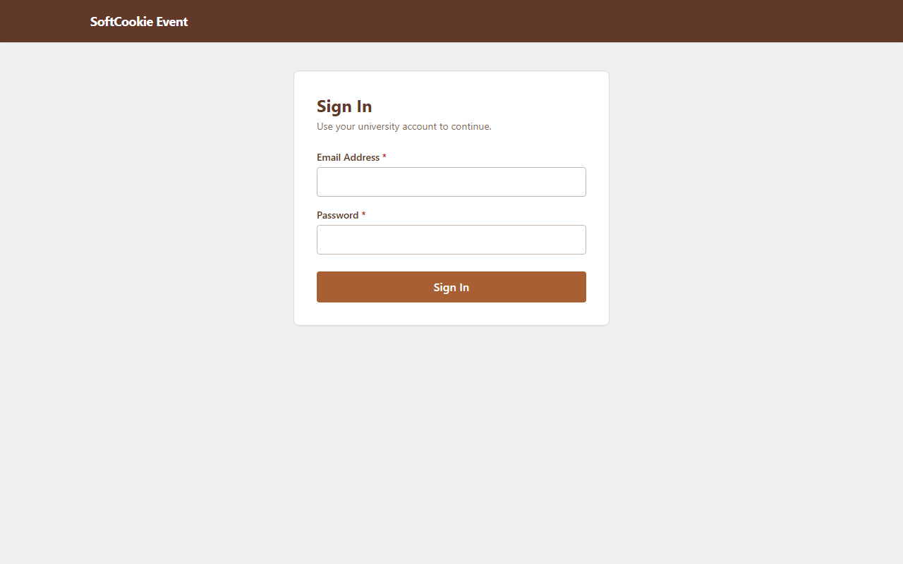 | 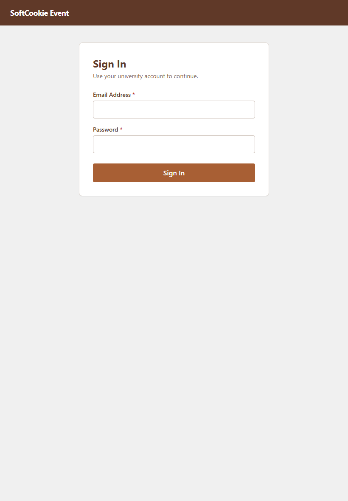 | 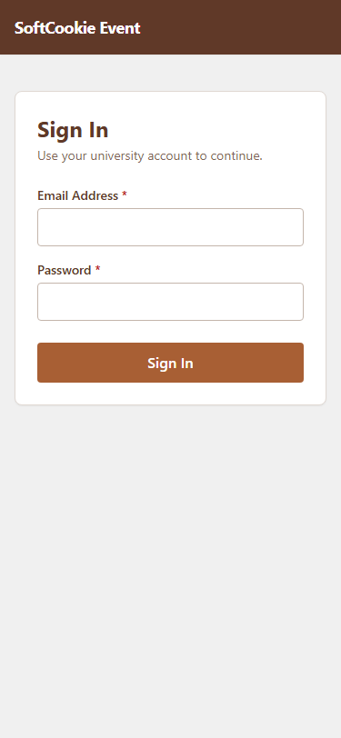 |

---

### 2.2 Event Discovery Catalog (`/events`)
- **Desktop (1280x800):** Two-column card grid with soonest-first sorting, seat availability badges, and deadline indicators.
- **Tablet (820x1180):** Fluid 2-column grid preserving card hierarchy and spacing.
- **Mobile (375x812):** Stacks into a clean single-column feed with full touch-friendly hit areas.

| Desktop (1280x800) | Tablet / iPad (820x1180) | Mobile / iPhone (375x812) |
| :---: | :---: | :---: |
| 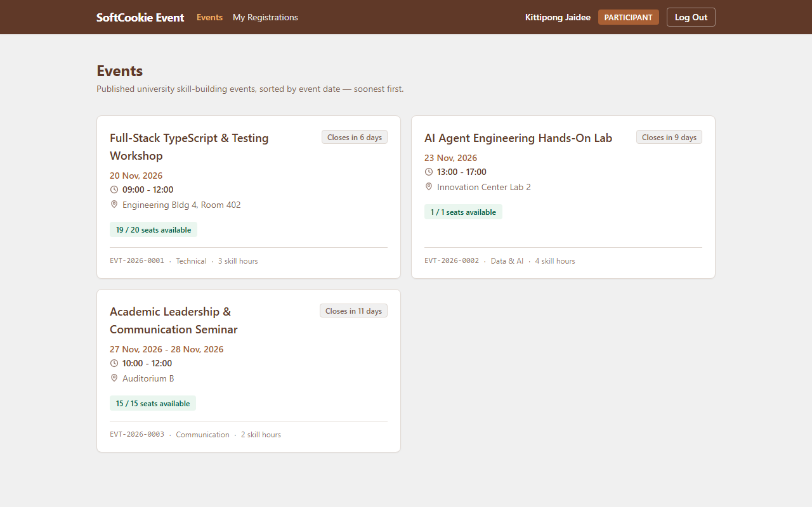 |  |  |

---

### 2.3 Event Detail & Registration (`/events/:id`)
- **Desktop (1280x800):** Comprehensive event overview with schedule, location, remaining seats badge, and action buttons. Registered state displays green `REGISTERED` badge and official ticket number. Owning organizers see "Organizer Controls" with "View Registrations Roster".
- **Tablet (820x1180):** Proportional padding with clear visual distinction between editable and read-only elements.
- **Mobile (375x812):** Single column stack with full-width register / view action buttons and registration confirmation banner.

| Desktop (1280x800) | Tablet / iPad (820x1180) | Mobile / iPhone (375x812) |
| :---: | :---: | :---: |
| 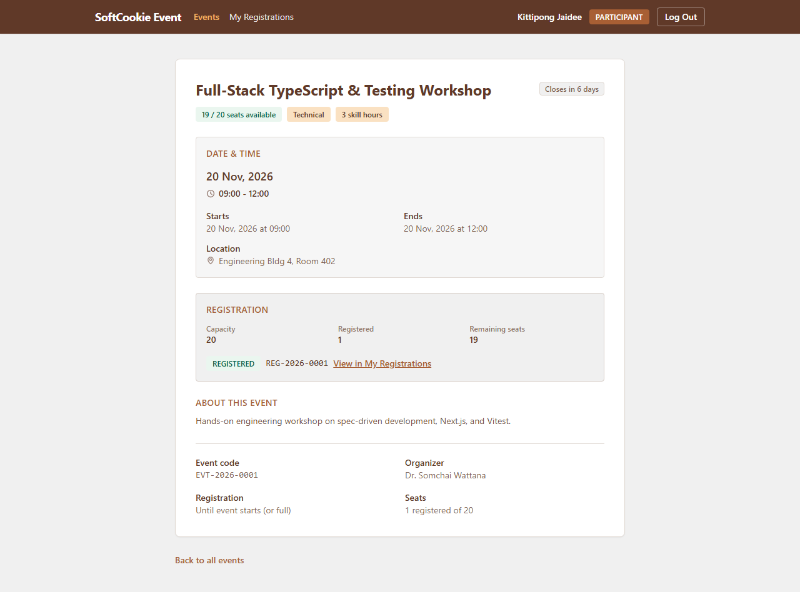 | 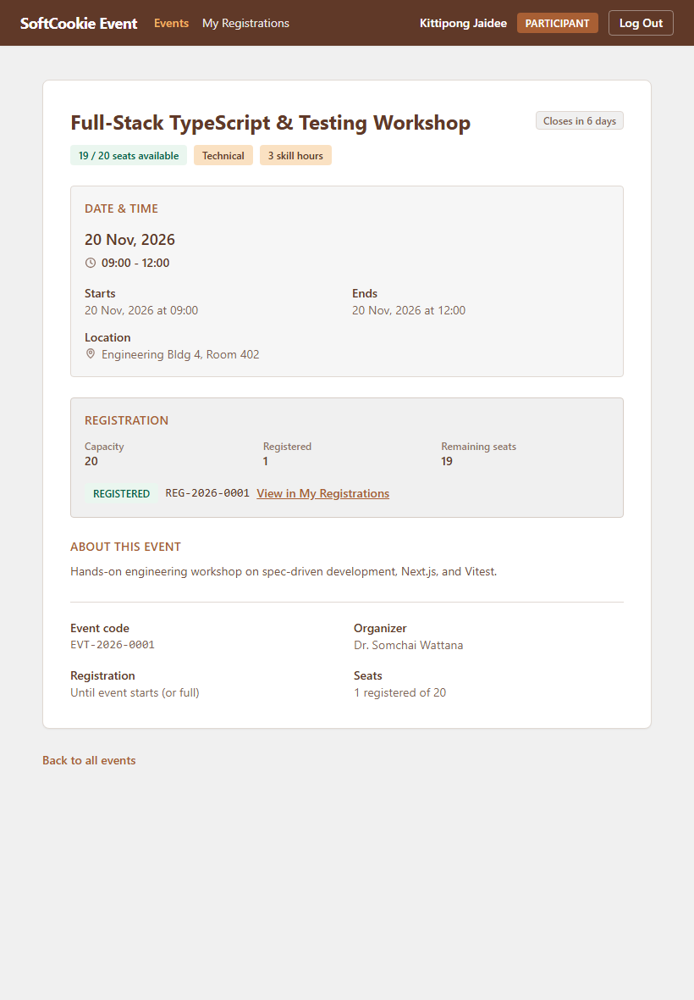 | 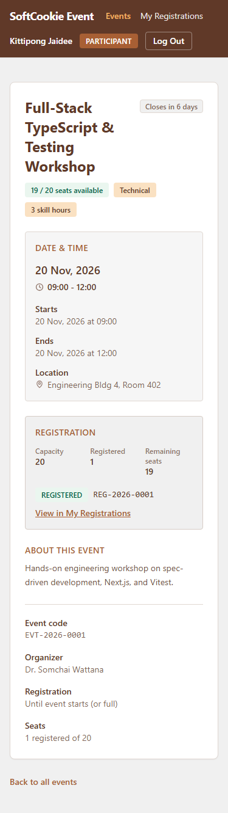 |

---

### 2.4 My Registrations (`/my-registrations`)
- **Desktop (1280x800):** Participant ticket history showing official registration codes (`REG-2026-NNNN`), event titles, date/time, and status pills.
- **Tablet (820x1180):** Preserves clear tabular metadata with wrap-safe badges.
- **Mobile (375x812):** Responsive stacked participant cards displaying event name, official ticket code, skill hours, date, and registration badge.

| Desktop (1280x800) | Tablet / iPad (820x1180) | Mobile / iPhone (375x812) |
| :---: | :---: | :---: |
| 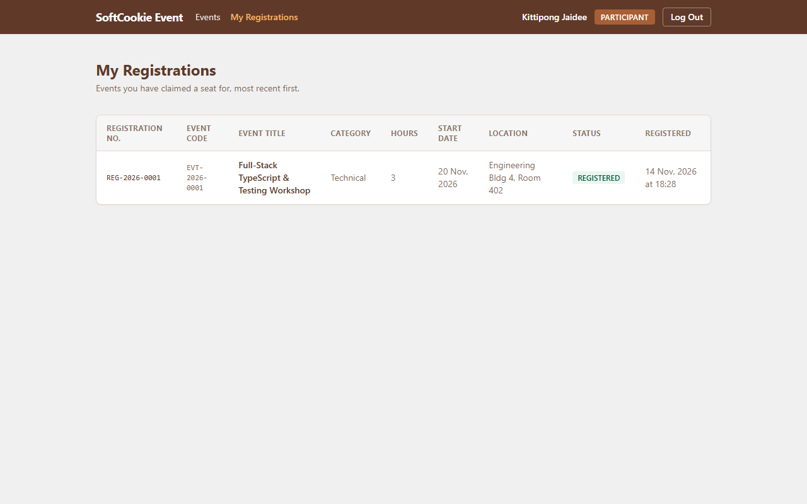 |  | 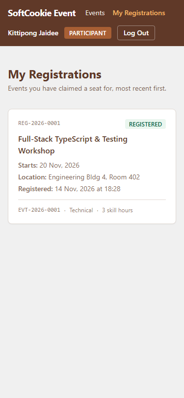 |

---

### 2.5 Create Event Page (`/events/new`)
- **Desktop (1280x800):** Side-by-side editable form inputs with `#F0F0F0` shaded read-only system fields (`Event Code`, `Organizer`).
- **Tablet (820x1180):** Adaptable form grid with red asterisk (`*`) markers above all required inputs.
- **Mobile (375x812):** Clean single-column form with inline validation below each field.

| Desktop (1280x800) | Tablet / iPad (820x1180) | Mobile / iPhone (375x812) |
| :---: | :---: | :---: |
| 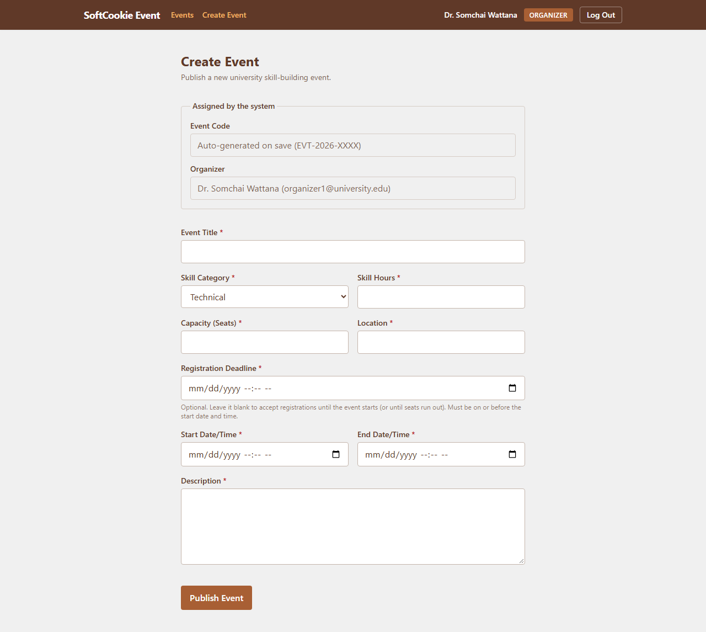 | 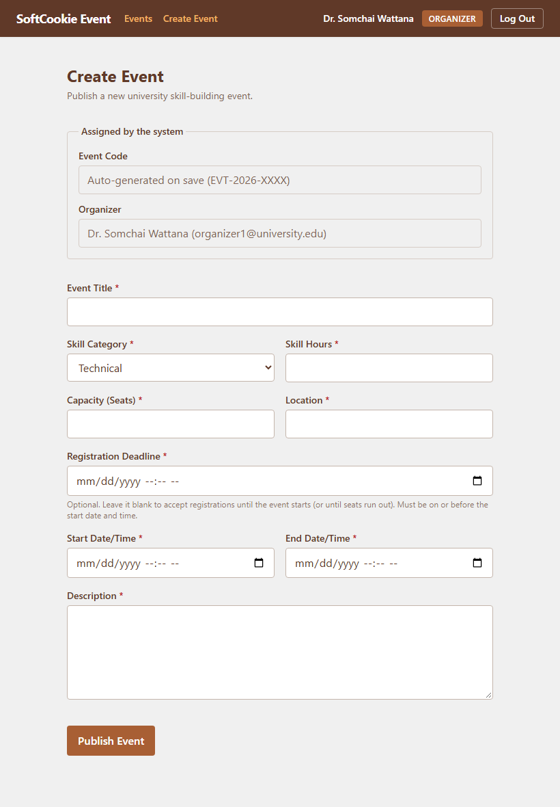 | 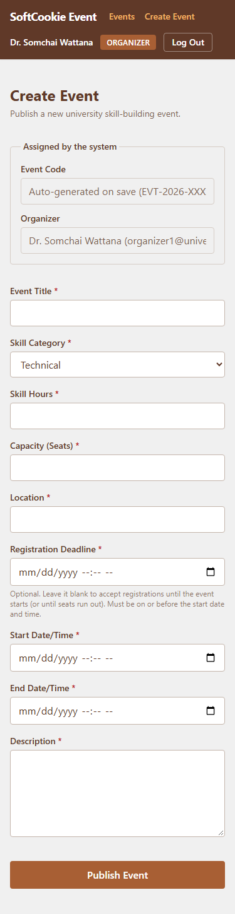 |

---

### 2.6 Organizer Registration Roster (`/organizer/events/:id/registrations`)
- **Desktop (1280x800):** Full 5-column data table (`Registration No.`, `Participant Name`, `Email`, `Status`, `Registered Date/Time`) with SoftCookie Cocoa/Caramel headers and populated participant records.
- **Tablet (820x1180):** Compact responsive table with legible spacing and full participant data.
- **Mobile (375x812):** **Responsive transformation** — table cleanly transitions into stacked mobile participant cards with registration number, participant details, and status pill to eliminate horizontal scroll.

| Desktop (1280x800) | Tablet / iPad (820x1180) | Mobile / iPhone (375x812) |
| :---: | :---: | :---: |
| 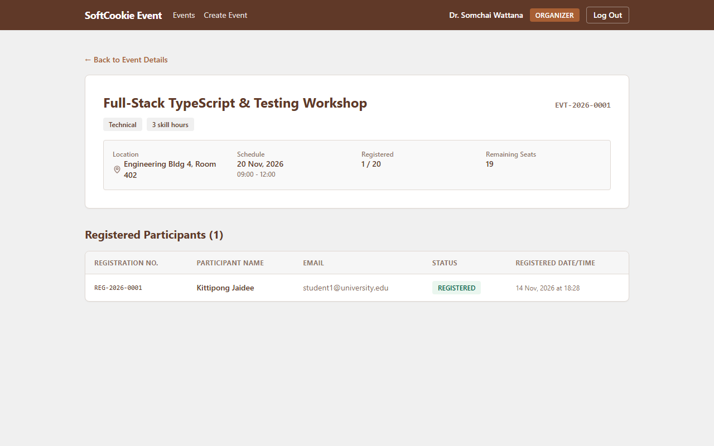 | 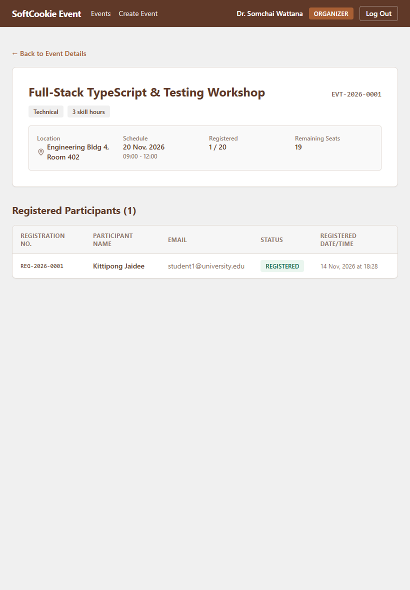 | 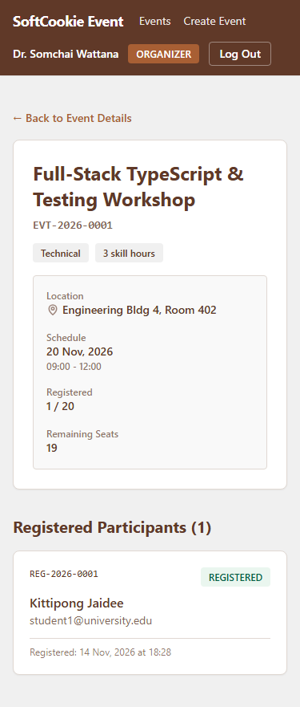 |
