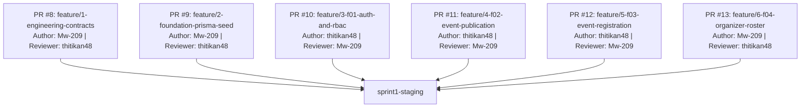

# Sprint 1 Peer Review Log & Team Contribution Record

**Course:** CPE 334 — Introduction to Software Engineering in the Age of AI Agents (Semester 1/2026)  
**Project Theme:** Theme 3 — Event Registration and Attendance System (University Skill-Building Context)  
**Team Name:** TH-011_SoftCookie  
**Sprint:** Sprint 1 Baseline Delivery  
**Document Version:** 1.0  
**Last Updated:** 2026-11-13  

---

## 1. Team Contribution Summary

| Team Member | Student ID | GitHub Username | Sprint 1 Focus Areas | PR Author | PR Reviewer | Estimated Contribution |
| :--- | :--- | :--- | :--- | :--- | :--- | :---: |
| **Kusumas Kerdbankram** | 67070505209 | `Mw-209` | Architecture specification, database foundation, seed script, F-04 backend/frontend implementation, branding/favicon UX enhancement, E2E & release verification | PR #8, PR #9, PR #13 | PR #10, PR #11, PR #12 | **50%** |
| **Thitikan Tiranobpakan** | 67070505213 | `thitikan48` | F-01 Auth/RBAC implementation, F-02 Event publication/discovery, F-03 atomic row-locked registration, SoftCookie responsive UI components, test automation | PR #10, PR #11, PR #12 | PR #8, PR #9, PR #13 | **50%** |

Both team members contributed equally across specifications, backend services, frontend components, automated test suites (Unit, API, UI, E2E), and mandatory cross-review of pull requests.

---

## 2. Pull Request Chain & Peer Review Log

Every feature branch in Sprint 1 was merged into `sprint1-staging` strictly via an approved pull request with peer review evidence (authors never approved their own pull requests).

### Detailed Review Records

#### PR #8: `feature/1-engineering-contracts`
- **Target Branch:** `sprint1-staging`
- **Author:** Kusumas Kerdbankram (`Mw-209`)
- **Reviewer:** Thitikan Tiranobpakan (`thitikan48`)
- **Merge Commit:** `e9bbc4d`
- **Scope:** Complete engineering baseline documents (`srs.md`, `system-sds.md`, `traceability.md`, `features.md`, `plan.md`) and Sprint 1 contracts (`AC-01`–`AC-20`, `TEST-01`–`TEST-38`).
- **Review Feedback & Resolution:**
  - *Review Comment:* Verify that all 38 planned tests trace back to functional requirements and acceptance criteria in the traceability matrix.
  - *Resolution:* Cross-checked `docs/traceability.md` to ensure zero orphan tests and 100% baseline coverage.
  - *Outcome:* Approved and merged into `sprint1-staging`.

#### PR #9: `feature/2-foundation-prisma-seed`
- **Target Branch:** `sprint1-staging`
- **Author:** Kusumas Kerdbankram (`Mw-209`)
- **Reviewer:** Thitikan Tiranobpakan (`thitikan48`)
- **Merge Commit:** `f20e3fe`
- **Scope:** Full-stack scaffold (Express server + React Vite client), Prisma schema, migrations, idempotent seed script, health/readiness probe routes (`/api/health`, `/api/ready`), and SoftCookie Warm Bakery Tailwind tokens.
- **Review Feedback & Resolution:**
  - *Review Comment:* Ensure seed script is completely idempotent and demo credentials match `.env.example`.
  - *Resolution:* Added `upsert` queries in `prisma/seed.ts` and set password via `DEMO_USER_PASSWORD` environment variable.
  - *Outcome:* Approved and merged into `sprint1-staging`.

#### PR #10: `feature/3-f01-auth-and-rbac`
- **Target Branch:** `sprint1-staging`
- **Author:** Thitikan Tiranobpakan (`thitikan48`)
- **Reviewer:** Kusumas Kerdbankram (`Mw-209`)
- **Merge Commit:** `27804a6`
- **Scope:** `F-01` Session-based authentication with bcrypt, secure HttpOnly cookie handling, RBAC route guards (`requireRole`), login page with validation & error handling, SoftCookie navbar.
- **Review Feedback & Resolution:**
  - *Review Comment:* Ensure session cookie uses `SameSite=Lax` and proper error codes (`INVALID_CREDENTIALS` on 401, `ACCOUNT_INACTIVE` on 403).
  - *Resolution:* Validated error response structure in `server/src/middleware/error-handler.ts` and confirmed unit/API tests pass.
  - *Outcome:* Approved and merged into `sprint1-staging`.

#### PR #11: `feature/4-f02-event-publication`
- **Target Branch:** `sprint1-staging`
- **Author:** Thitikan Tiranobpakan (`thitikan48`)
- **Reviewer:** Kusumas Kerdbankram (`Mw-209`)
- **Merge Commit:** `529d7cf`
- **Scope:** `F-02` Event publication with server-side validation (`BR-01`), event catalog with soonest-first sorting, event detail page, seat availability badges, and TDD suite (`TEST-10`–`TEST-21`).
- **Review Feedback & Resolution:**
  - *Review Comment:* Check that system-assigned fields (e.g., auto-generated event code `EVT-2026-XXXX`) cannot be overwritten by client payloads and display with `#F0F0F0` read-only styling.
  - *Resolution:* Enforced server-side code generation and styled read-only inputs accordingly in `CreateEventPage.tsx`.
  - *Outcome:* Approved and merged into `sprint1-staging`.

#### PR #12: `feature/5-f03-event-registration`
- **Target Branch:** `sprint1-staging`
- **Author:** Thitikan Tiranobpakan (`thitikan48`)
- **Reviewer:** Kusumas Kerdbankram (`Mw-209`)
- **Merge Commit:** `20641ba`
- **Scope:** `F-03` Event registration with pessimistic row-locking (`SELECT ... FOR UPDATE`, `BR-02`), registration code generation (`REG-2026-NNNN`), participant registration history (`/my-registrations`), cross-participant privacy protection (`BR-05`).
- **Review Feedback & Resolution:**
  - *Review Comment:* Ensure concurrent registration requests for the last seat correctly reject overflow participants without negative seat counts.
  - *Resolution:* Verified `TEST-25` concurrent stress test with row-locking in transaction.
  - *Outcome:* Approved and merged into `sprint1-staging`.

#### PR #13: `feature/6-f04-organizer-roster`
- **Target Branch:** `sprint1-staging`
- **Author:** Kusumas Kerdbankram (`Mw-209`)
- **Reviewer:** Thitikan Tiranobpakan (`thitikan48`)
- **Merge Commit:** `50ea1b5`
- **Scope:** `F-04` Organizer registration roster endpoint (`GET /api/events/:id/registrations`) with strict ownership check (`BR-05`), roster inspection page with desktop table and mobile card layout, "Organizer Controls" section on event detail, plus transparent cookie favicon enhancement.
- **Review Feedback & Resolution:**
  - *Review Comment 1:* Drop unused `ClockIcon` import in `OrganizerRosterPage.tsx`.
  - *Review Comment 2:* Avoid querying registrations twice in `event.service.ts` (drop `include` from `event.findUnique` and calculate count from `registration.findMany`).
  - *Review Comment 3:* Reuse `ACTIVE_REGISTRATION_STATUSES` from `registration.service.ts` as single source of truth.
  - *Review Comment 4:* Type `status` as `RegistrationStatus` enum and use `ApiError.notFound("Event")`.
  - *Resolution:* Addressed all 4 points in commit `4312936`, verified all 107 server and 73 client tests pass.
  - *Outcome:* Approved and merged into `sprint1-staging`.
